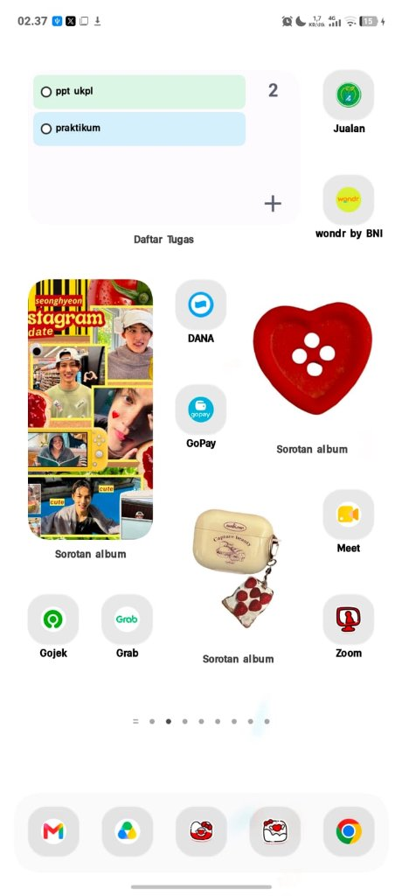
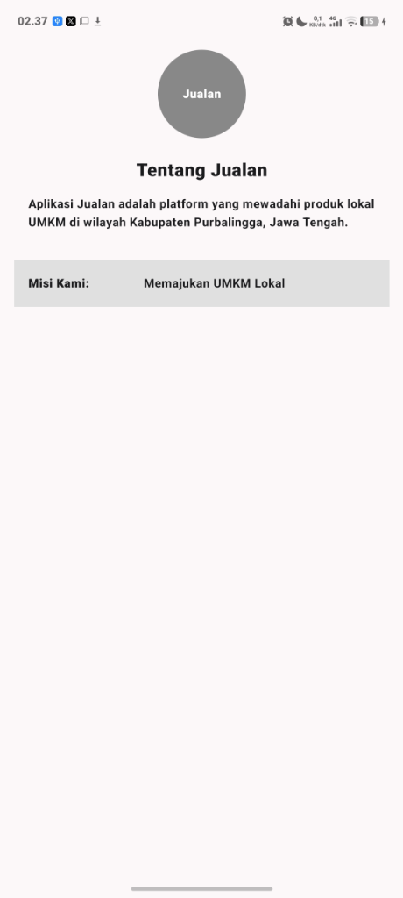

# Laporan Praktikum Pemrograman Mobile

**Nama**        : Putri Isnaini Laksita Utami  
**NIM**         : H1D024078  
**Shift**       : Awal H / Akhir E  
**Praktikum**   : Pemrograman Mobile

---

## 📝 Tugas Pertemuan 1
**Tanggal**: Rabu, 2 September 2026

| Icon Aplikasi | Light Mode | Dark Mode |
| :---: | :---: | :---: |
|  |  |  |

**Kesimpulan Praktikum:**  
Pada pertemuan pertama, praktikum membahas inisialisasi proyek Android menggunakan Kotlin dan Jetpack Compose dengan pendekatan *Declarative UI*, pengenalan struktur proyek Android serta penggantian ikon aplikasi, dan pembuatan komponen `@Composable` sederhana (`LayoutTentangJualan`) menggunakan tata letak dasar `Column`, `Box`, `Spacer`, `Text`, dan `Row` pada `MainActivity.kt`.
