# Laporan Praktikum Pemrograman Mobile

**Nama**        : Putri Isnaini Laksita Utami  
**NIM**         : H1D024078  
**Shift**       : Awal H / Akhir E  
**Praktikum**   : Pemrograman Mobile

---

## 📝 Tugas Pertemuan 1
**Tanggal**: Rabu, 2 September 2026

| Icon Aplikasi | Light Mode | Dark Mode |
| :---: | :---: | :---: |
|  |  |  |

**Kesimpulan Praktikum:**  
Pada pertemuan pertama, praktikum membahas inisialisasi proyek Android menggunakan Kotlin dan Jetpack Compose dengan pendekatan *Declarative UI*, pengenalan struktur proyek Android serta penggantian ikon aplikasi, dan pembuatan komponen `@Composable` sederhana (`LayoutTentangJualan`) menggunakan tata letak dasar `Column`, `Box`, `Spacer`, `Text`, dan `Row` pada `MainActivity.kt`.

---

## 📝 Tugas Pertemuan 2
**Tanggal**: Rabu, 9 September 2026

**Light Mode**

| Tentang Jualan | Hubungi Kami |
| :---: | :---: |
|  |  |

**Dark Mode**

| Tentang Jualan | Hubungi Kami |
| :---: | :---: |
|  | 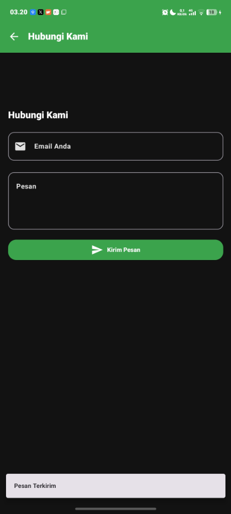 |

**Kesimpulan Praktikum:**  
Pada pertemuan kedua, praktikum mempelajari penerapan Material Design 3 menggunakan Jetpack Compose, meliputi pengaturan palet warna (`Color.kt`), tema terang/gelap serta menonaktifkan *Dynamic Color* (`Theme.kt`), dan tipografi (`Type.kt`). Selain itu, dilakukan pembuatan layar baru (`BasicInfoScreen` dan `HubungiKamiScreen`) dengan komponen `Scaffold`, `TopAppBar`, `Card`, `OutlinedTextField`, `Button`, *Vector Asset* ikon, `Snackbar` untuk umpan balik pengiriman pesan, serta navigasi antar layar menggunakan `NavHost` dan `NavController`.

---

## 📝 Tugas Pertemuan 3
**Tanggal**: Rabu, 16 September 2026

**Light Mode**

| Kategori Makanan | Kategori Minuman | Kategori Kerajinan |
| :---: | :---: | :---: |
| 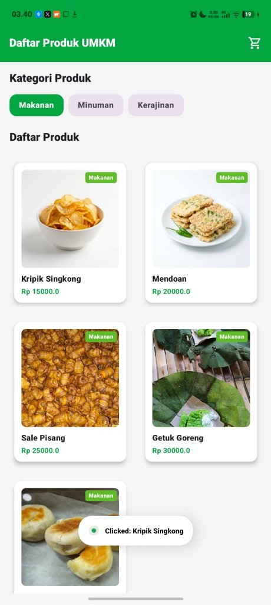 | 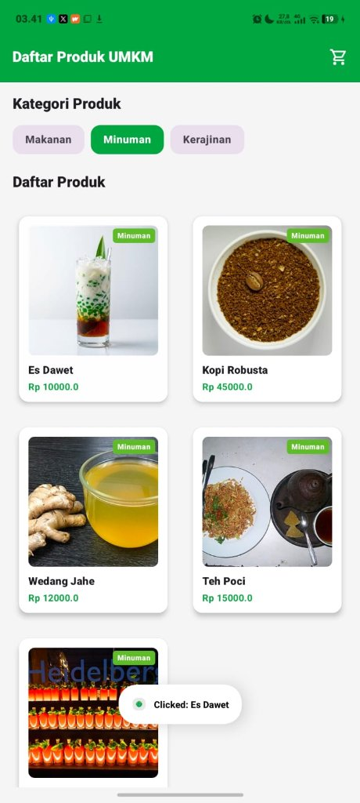 | 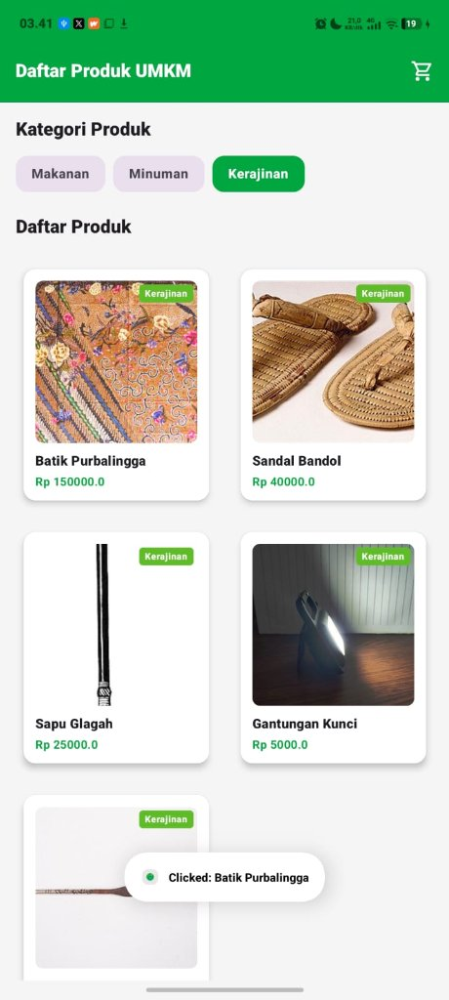 |

**Dark Mode**

| Kategori Makanan | Kategori Minuman | Kategori Kerajinan |
| :---: | :---: | :---: |
| 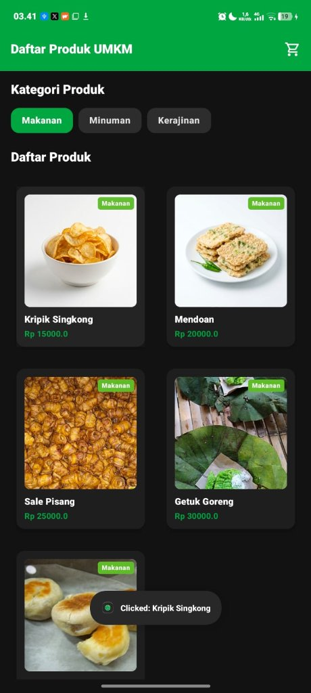 | 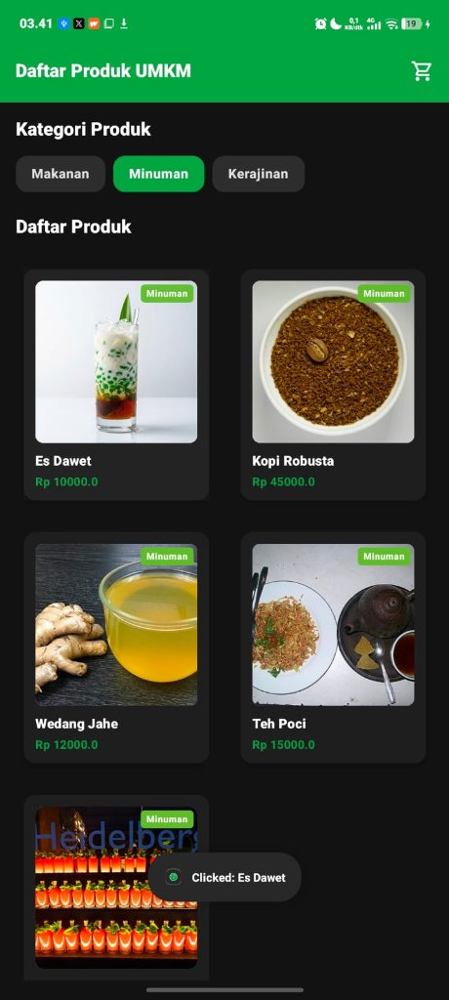 | 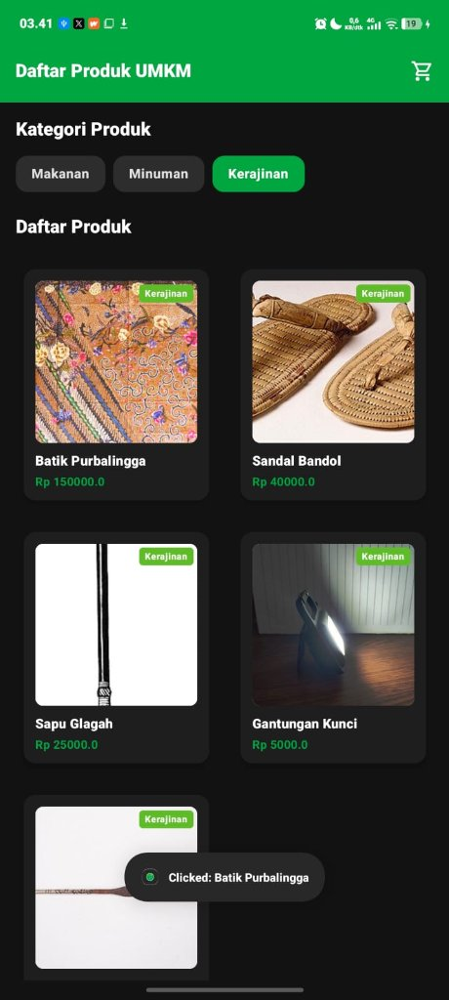 |

**Kesimpulan Praktikum:**  
Pada pertemuan ketiga, praktikum mempelajari penerapan *Dynamic Lists* menggunakan *Lazy Layouts* di Jetpack Compose. Mahasiswa membuat struktur data menggunakan Kotlin `data class` (`Category` dan `Product`) dengan fitur *null-safety*, menyediakan data tiruan melalui *Singleton* `object DummyData`, menyusun daftar kategori horizontal menggunakan `LazyRow` serta daftar produk dua kolom menggunakan `LazyVerticalGrid` yang difilter berdasarkan kategori aktif, menambahkan umpan balik `Toast` saat produk diklik, membuat `@Preview` tema terang dan gelap, serta menambahkan `HomeActivity` sebagai *Launcher Activity* baru di `AndroidManifest.xml`.

---

## 📝 Tugas Pertemuan 4
**Tanggal**: Rabu, 23 September 2026

**Light Mode**

| Daftar Produk & Menu | Detail Produk | Form Hubungi Kami |
| :---: | :---: | :---: |
| 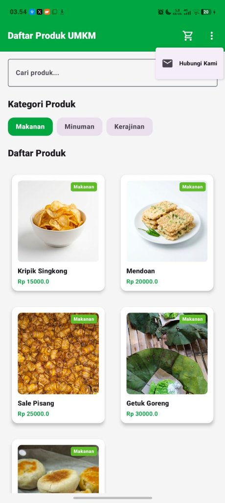 | 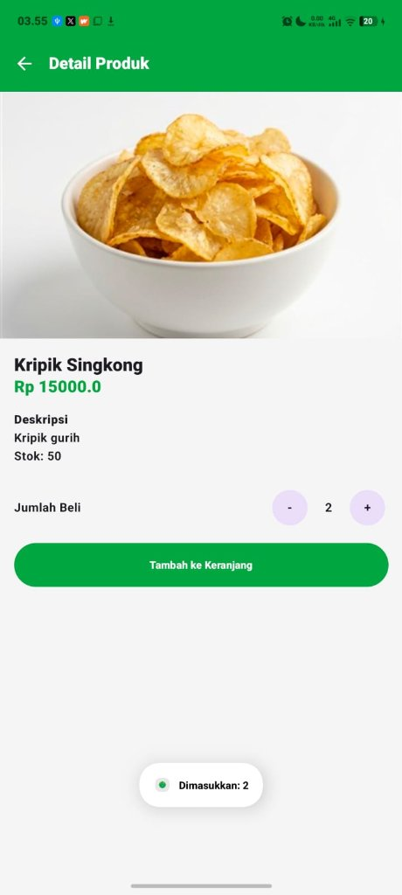 | 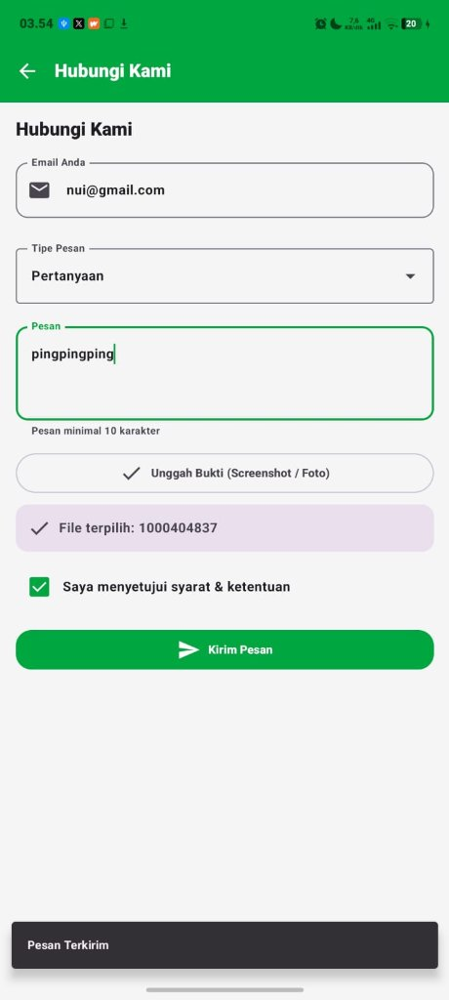 |

**Dark Mode**

| Daftar Produk & Menu | Detail Produk | Form Hubungi Kami |
| :---: | :---: | :---: |
| 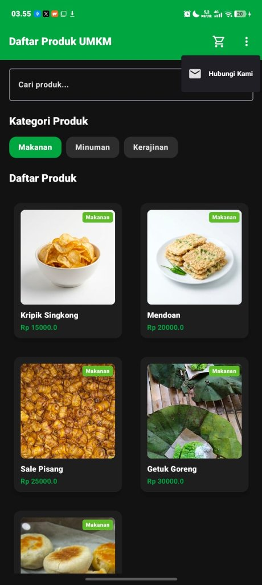 | 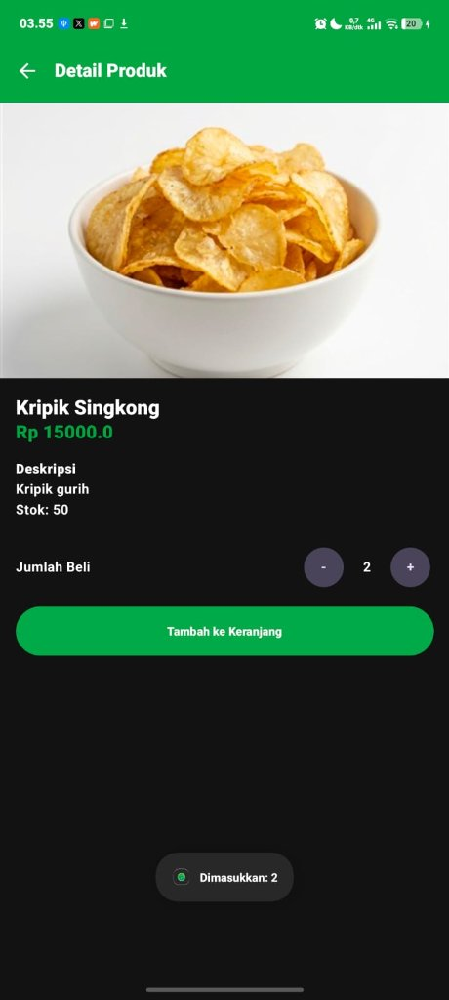 | 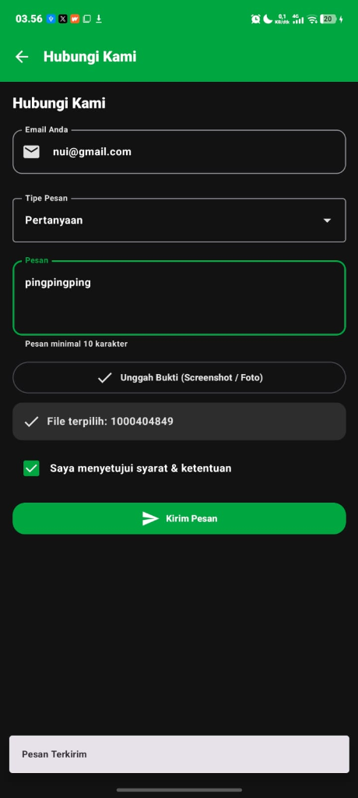 |

**Kesimpulan Praktikum:**  
Pada pertemuan keempat, praktikum mempelajari pengelolaan *State*, *Recomposition*, dan *UI Lifecycle* di Jetpack Compose dengan menerapkan *State Hoisting* serta pola *Unidirectional Data Flow (UDF)* untuk memisahkan komponen *Stateful* dan *Stateless* (`StatelessFormHubungiKami`, `StatelessDaftarProduct`, dan `StatelessDetailProduct`). Mahasiswa mengimplementasikan `rememberSaveable`, validasi form interaktif (`ExposedDropdownMenuBox`, `PickVisualMedia`, `Checkbox`, serta izin akses media di `AndroidManifest.xml`), simulasi proses asinkronus menggunakan `LaunchedEffect` dan `delay`, fitur pencarian produk, halaman detail produk dengan pengaturan jumlah beli, serta navigasi antar halaman menggunakan `NavHost` beserta pengiriman argumen `productId` dan menu aksi di `TopAppBar`.
