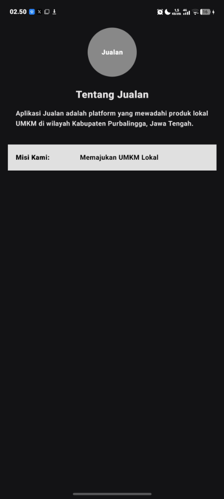
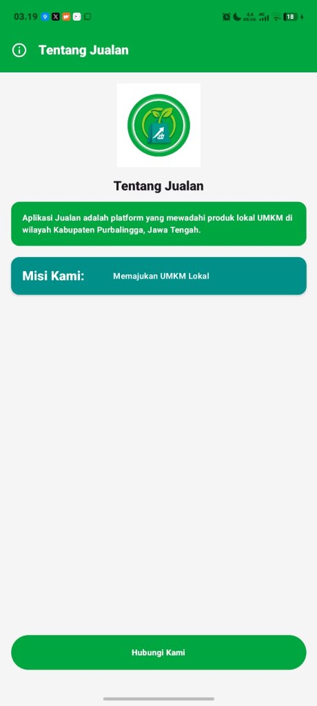
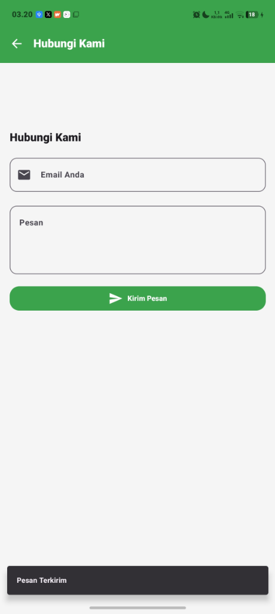
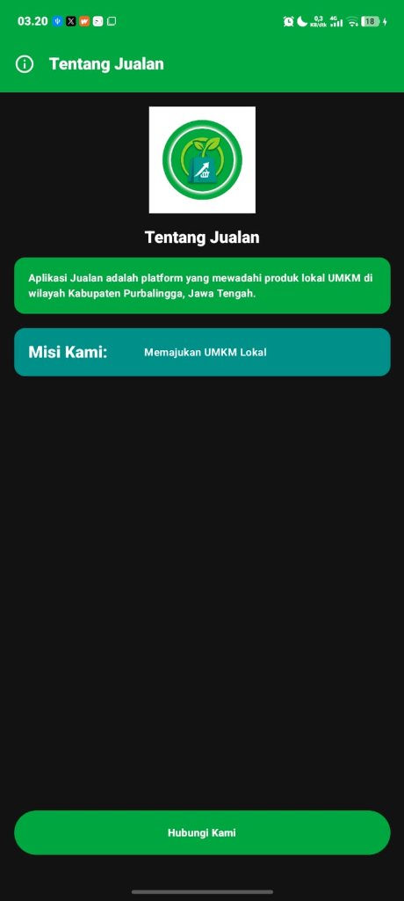

# Laporan Praktikum Pemrograman Mobile

**Nama**        : Putri Isnaini Laksita Utami  
**NIM**         : H1D024078  
**Shift**       : Awal H / Akhir E  
**Praktikum**   : Pemrograman Mobile

---

## 📝 Tugas Pertemuan 1
**Tanggal**: Rabu, 2 September 2026

| Icon Aplikasi | Light Mode | Dark Mode |
| :---: | :---: | :---: |
|  |  |  |

**Kesimpulan Praktikum:**  
Pada pertemuan pertama, praktikum membahas inisialisasi proyek Android menggunakan Kotlin dan Jetpack Compose dengan pendekatan *Declarative UI*, pengenalan struktur proyek Android serta penggantian ikon aplikasi, dan pembuatan komponen `@Composable` sederhana (`LayoutTentangJualan`) menggunakan tata letak dasar `Column`, `Box`, `Spacer`, `Text`, dan `Row` pada `MainActivity.kt`.

---

## 📝 Tugas Pertemuan 2
**Tanggal**: Rabu, 9 September 2026

**Light Mode**

| Tentang Jualan | Hubungi Kami |
| :---: | :---: |
|  |  |

**Dark Mode**

| Tentang Jualan | Hubungi Kami |
| :---: | :---: |
|  |  |

**Kesimpulan Praktikum:**  
Pada pertemuan kedua, praktikum mempelajari penerapan Material Design 3 menggunakan Jetpack Compose, meliputi pengaturan palet warna (`Color.kt`), tema terang/gelap serta menonaktifkan *Dynamic Color* (`Theme.kt`), dan tipografi (`Type.kt`). Selain itu, dilakukan pembuatan layar baru (`BasicInfoScreen` dan `HubungiKamiScreen`) dengan komponen `Scaffold`, `TopAppBar`, `Card`, `OutlinedTextField`, `Button`, *Vector Asset* ikon, `Snackbar` untuk umpan balik pengiriman pesan, serta navigasi antar layar menggunakan `NavHost` dan `NavController`.
